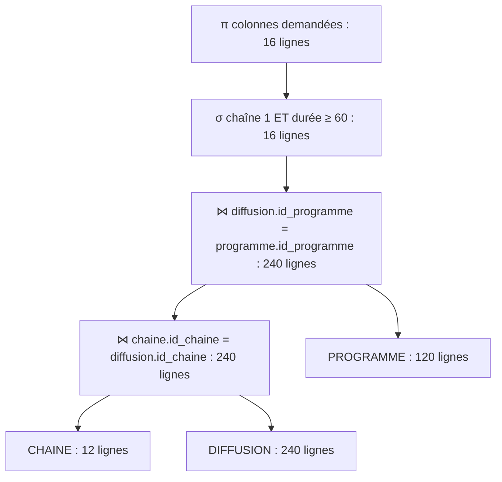
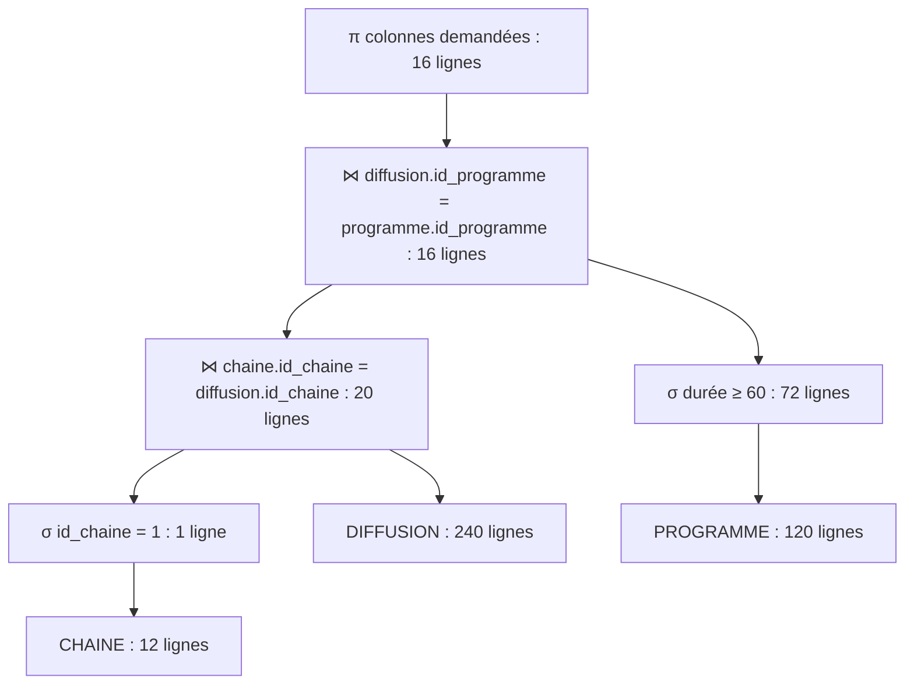

# Projet MERISE — Télédiffusion audiovisuelle


## 1. Prompt final utilisé


Tu travailles dans le domaine de la télédiffusion audiovisuelle.

Ton entreprise a comme activité de diffuser des programmes de télévision auprès du public, en assurant la programmation, la gestion des contenus audiovisuels, des chaînes, des créneaux de diffusion et des différentes modalités de distribution des programmes.

C’est une entreprise du secteur audiovisuel comme TF1, France Télévisions, M6 ou Canal+.

Les données ont été collectées à partir des informations concernant les chaînes de télévision, les programmes diffusés, les émissions, les contenus audiovisuels, les horaires et créneaux de diffusion, les catégories de programmes, les présentateurs et intervenants, les producteurs, les audiences et les supports ou modes de diffusion.

Inspire-toi des sites web officiels et des informations publiques suivants : TF1, France Télévisions, M6 et Canal+.

Ton entreprise veut appliquer MERISE pour concevoir un système d’information.

Tu es chargé de la partie analyse, c’est-à-dire de collecter les besoins auprès de l’entreprise. Elle a fait appel à un étudiant en ingénierie informatique pour réaliser ce projet. Tu dois lui fournir les informations nécessaires pour qu’il applique ensuite lui-même les étapes suivantes de conception et de développement de la base de données.

D’abord, établis les règles de gestion des données de ton entreprise, sous la forme d’une liste à puces.

Les règles de gestion doivent correspondre aux informations que fournit quelqu’un qui connaît le fonctionnement de l’entreprise, mais pas comment se construit un système d’information. Elles ne doivent donc pas contenir de notions techniques de modélisation telles que les clés primaires, les clés étrangères, les tables ou les relations.

Ensuite, à partir de ces règles, fournis un dictionnaire de données brutes avec les colonnes suivantes, regroupées dans un tableau :
- signification de la donnée ;
- type ;
- taille en nombre de caractères ou de chiffres.

Il doit y avoir entre 25 et 35 données.

Le dictionnaire doit fournir des informations supplémentaires sur chaque donnée, notamment son type et sa taille, mais sans a priori sur la manière dont les données seront modélisées ensuite.

Fournis donc :
1. les règles de gestion ;
2. le dictionnaire de données brutes.


## 2. Règles métier

Dans le cadre de notre entreprise de télédiffusion audiovisuelle, nous avons identifié les règles de gestion suivantes :

### Gestion des chaînes et des programmes

- L'entreprise gère plusieurs chaînes de télévision.
- Chaque chaîne possède un nom et une description.
- Une chaîne peut diffuser plusieurs programmes à des dates et horaires différents.
- Chaque programme possède un titre, une description, une durée en minutes et une année de production.
- Un programme représente un contenu éditorial pouvant être diffusé, comme un film, un documentaire, un événement sportif ou un épisode d'émission.
- Chaque programme appartient obligatoirement à une seule catégorie.
- Une catégorie peut regrouper plusieurs programmes.
- Les catégories comprennent notamment le sport, l'information, le divertissement, les documentaires et les fictions.

### Gestion des émissions et des épisodes

- Une émission est une production télévisuelle récurrente qui peut comporter plusieurs épisodes.
- Chaque émission possède un nom qui permet de la distinguer des autres émissions.
- Une émission peut comporter plusieurs épisodes.
- Chaque épisode appartient obligatoirement à une seule émission.
- Chaque épisode possède un numéro unique au sein de son émission.
- Deux émissions différentes peuvent posséder des épisodes ayant le même numéro.
- Pour identifier précisément un épisode, il est nécessaire de connaître son numéro ainsi que l'émission à laquelle il appartient.
- Chaque épisode correspond obligatoirement à un seul programme pouvant être diffusé.
- Un programme peut correspondre à un épisode d'émission ou être indépendant de toute émission.
- Un programme ne peut correspondre qu'à un seul épisode au maximum.
- Le nom de l'émission désigne la production récurrente, tandis que le titre du programme désigne le contenu précis pouvant être diffusé.

### Gestion des diffusions et des horaires

- Un même programme peut être diffusé plusieurs fois, sur une ou plusieurs chaînes.
- Chaque diffusion concerne obligatoirement un seul programme et une seule chaîne de télévision.
- Chaque diffusion possède une date de début, une heure de début, une date de fin et une heure de fin.
- Une diffusion peut commencer un jour et se terminer le lendemain.
- La date et l'heure de fin d'une diffusion doivent être postérieures à sa date et son heure de début.
- Sur une même chaîne, deux diffusions ne peuvent pas avoir des créneaux horaires qui se chevauchent.
- Plusieurs chaînes peuvent diffuser des programmes simultanément.
- Les dates et horaires permettent à l'entreprise d'organiser et de consulter sa grille de programmation.

### Gestion des producteurs et des intervenants

- Un programme peut être produit par un ou plusieurs producteurs.
- Un producteur peut participer à la production de plusieurs programmes.
- Chaque producteur possède un nom et un prénom.
- L'entreprise conserve les informations relatives aux personnes intervenant dans les émissions.
- Les intervenants peuvent être des présentateurs, des journalistes, des chroniqueurs ou des experts.
- Chaque intervenant possède un nom, un prénom et une fonction générale.
- Une émission peut accueillir plusieurs intervenants.
- Un intervenant peut participer à plusieurs émissions.
- Les présentateurs sont considérés comme des intervenants et ne sont donc pas gérés séparément.

### Gestion des contenus audiovisuels

- L'entreprise conserve les informations relatives aux contenus audiovisuels utilisés dans ses programmes.
- Chaque contenu audiovisuel possède un titre, un type et une durée en minutes.
- Les contenus audiovisuels peuvent correspondre à des reportages, des vidéos, des interviews ou des extraits.
- Un programme peut utiliser plusieurs contenus audiovisuels.
- Un même contenu audiovisuel peut être utilisé dans plusieurs programmes.
- Un contenu audiovisuel peut être créé à partir d'un autre contenu audiovisuel existant, par exemple un extrait réalisé à partir d'un reportage complet.
- Un contenu audiovisuel d'origine peut servir à créer plusieurs contenus dérivés.
- Un contenu audiovisuel dérivé possède au maximum un seul contenu d'origine direct.
- Certains contenus audiovisuels sont des contenus originaux qui ne proviennent d'aucun autre contenu.
- Un contenu audiovisuel ne peut pas être directement ou indirectement dérivé de lui-même.

### Gestion des modes de diffusion

- L'entreprise propose plusieurs modes de diffusion pour distribuer ses programmes.
- Les programmes peuvent être distribués par la télévision, le streaming ou les services de replay.
- Chaque mode de diffusion possède un nom.
- Un programme peut être disponible sur plusieurs modes de diffusion.
- Un même mode de diffusion peut être utilisé pour plusieurs programmes.

### Gestion des audiences

- L'entreprise suit les audiences des programmes diffusés sur ses chaînes.
- Chaque diffusion peut disposer d'une mesure d'audience après sa réalisation.
- Chaque mesure d'audience concerne obligatoirement une seule diffusion.
- Une diffusion possède au maximum une mesure d'audience globale.
- Une mesure d'audience comprend le nombre de téléspectateurs et la part d'audience du programme diffusé.
- Le nombre de téléspectateurs ne peut pas être négatif.
- La part d'audience est exprimée en pourcentage et doit être comprise entre 0 et 100.


## 3. Dictionnaire de données brutes

Ce dictionnaire présente les données utilisées par notre
entreprise de télédiffusion audiovisuelle, ainsi que leur
type et leur taille.

| N° | Signification de la donnée | Type | Taille |
|---|---|---|---|
| 1 | Identifiant de la chaîne | INT | 5 chiffres |
| 2 | Nom de la chaîne | VARCHAR | 50 caractères |
| 3 | Description de la chaîne | VARCHAR | 255 caractères |
| 4 | Identifiant du programme | INT | 6 chiffres |
| 5 | Titre du programme | VARCHAR | 100 caractères |
| 6 | Description du programme | VARCHAR | 500 caractères |
| 7 | Durée du programme en minutes | INT | 4 chiffres |
| 8 | Année de production | CHAR | 4 caractères |
| 9 | Identifiant de la catégorie | INT | 4 chiffres |
| 10 | Nom de la catégorie | VARCHAR | 50 caractères |
| 11 | Identifiant du producteur | INT | 6 chiffres |
| 12 | Nom du producteur | VARCHAR | 100 caractères |
| 13 | Prénom du producteur | VARCHAR | 50 caractères |
| 14 | Identifiant de l'intervenant | INT | 6 chiffres |
| 15 | Nom de l'intervenant | VARCHAR | 50 caractères |
| 16 | Prénom de l'intervenant | VARCHAR | 50 caractères |
| 17 | Fonction de l'intervenant | VARCHAR | 50 caractères |
| 18 | Identifiant de la diffusion | INT | 7 chiffres |
| 19 | Date de début de diffusion | DATE | 10 caractères |
| 20 | Heure de début de diffusion | TIME | 8 caractères |
| 21 | Heure de fin de diffusion | TIME | 8 caractères |
| 22 | Identifiant de l'émission | INT | 6 chiffres |
| 23 | Nom de l'émission | VARCHAR | 100 caractères |
| 24 | Identifiant de l'audience | INT | 8 chiffres |
| 25 | Nombre de téléspectateurs | BIGINT | 10 chiffres |
| 26 | Part d'audience | DECIMAL | 5 chiffres dont 2 décimales |
| 27 | Identifiant du mode de diffusion | INT | 4 chiffres |
| 28 | Nom du mode de diffusion | VARCHAR | 50 caractères |
| 29 | Type de contenu audiovisuel | VARCHAR | 50 caractères |
| 30 | Identifiant du contenu audiovisuel | INT | 6 chiffres |
| 31 | Titre du contenu audiovisuel | VARCHAR | 100 caractères |
| 32 | Durée du contenu audiovisuel en minutes | INT | 4 chiffres |
| 33 | Numéro de l'épisode | INT | 4 chiffres |
| 34 | Date de fin de diffusion | DATE | 10 caractères |


## 4. Modèle Conceptuel de Données (MCD)


## 5. Modèle Logique de Données (MLD)


Le symbole `#` représente une clé étrangère.
Le symbole `*` indique une clé étrangère facultative.

```text
chaine = (id_chaine INT, nom_chaine VARCHAR(50), description_chaine VARCHAR(250));

categorie = (id_categorie INT, nom_categorie VARCHAR(100));

producteur = (id_producteur INT, nom_producteur VARCHAR(100), prenom_producteur VARCHAR(100));

intervenant = (id_intervenant INT, nom_intervenant VARCHAR(100), prenom_intervenant VARCHAR(100), fonction_intervenant VARCHAR(100));

emission = (id_emission INT, nom_emission VARCHAR(100));

mode_diffusion = (id_mode INT, nom_mode VARCHAR(100));

contenu_audiovisuel = (id_contenu INT, titre_contenu VARCHAR(100), type_contenu VARCHAR(100), duree_contenu INT, #id_contenu_origine*);

programme = (Id_programme INT, titre_programme VARCHAR(100), description_programmme VARCHAR(255), duree_programme INT, annee_production INT, #id_categorie);

diffusion = (id_diffusion INT, date_debut_diffusion DATE, heure_debut_diffusion TIME, heure_fin_diffusion TIME, date_fin_diffusion DATE, #Id_programme, #id_chaine);

audience = (id_audience INT, part_audience DECIMAL(5,2), nbre_telespectateurs BIGINT, #id_diffusion);

episode = (#id_emission, num_episode INT, #Id_programme);

produire = (#Id_programme, #id_producteur);

participer = (#id_intervenant, #id_emission);

utiliser = (#Id_programme, #id_contenu);

distribuer = (#Id_programme, #id_mode);
```

### Particularités du MLD

- **Entité faible EPISODE :** la clé primaire est composée de `id_emission` et `num_episode`.
- **Association récursive DERIVER_DE :** `id_contenu_origine` est une clé étrangère facultative qui référence `contenu_audiovisuel`.
- **Associations plusieurs-à-plusieurs :** `produire`, `participer`, `utiliser` et `distribuer` sont représentées par des tables d'association dont les clés primaires sont composées des deux clés étrangères.
- **Autres tables :** leur clé primaire correspond à l'attribut `id` de chaque table.

Le modèle contient **15 tables**, dont 4 tables d'association.


## 6. Interrogation de la base de données

### 1. Scénario d'utilisation

**Rôle :** responsable de la programmation et des audiences d'une entreprise de télédiffusion audiovisuelle fictive.

**Situation :** avant de préparer la prochaine grille de programmation, cette personne souhaite étudier les programmes déjà diffusés sur les chaînes, la répartition des catégories et les performances d'audience.

**Données à extraire :**

- Les programmes disponibles, leurs durées, leurs années de production et leurs catégories.
- Les types de contenus audiovisuels disponibles.
- Le nombre de diffusions par chaîne et les émissions comportant plusieurs épisodes.
- La part d'audience moyenne par chaîne et le cumul de téléspectateurs par programme.
- Les programmes diffusés sur une chaîne, les diffusions sans mesure d'audience et les modes de diffusion des programmes.
- Les programmes sans épisode et les programmes présentant les durées les plus élevées.

**Objectif :** aider le responsable à identifier les programmes adaptés aux chaînes, à repérer les informations d'audience manquantes et à orienter ses choix pour la prochaine grille.

Le fichier [`4_interrogation.sql`](4_interrogation.sql) contient **21 requêtes** et précise en commentaire les données recherchées pour chacune :

| Famille de requêtes | Numéros | Nombre |
|---|---|---:|
| Sélections, projections, `ORDER BY`, `DISTINCT`, `LIKE`, `IN`, `BETWEEN` | Q01 à Q05 | 5 |
| Agrégations, `GROUP BY`, `HAVING` | Q06 à Q10 | 5 |
| Jointures internes, externes et multiples | Q11 à Q15 | 5 |
| Requêtes imbriquées : `IN`, `NOT IN`, `EXISTS`, `NOT EXISTS`, `ANY`, `ALL` | Q16 à Q21 | 6 |
| **Total** | | **21** |

### 2. Analyse de deux plans d'exécution d'une requête

#### Requête retenue : Q11

**Besoin :** retrouver les diffusions de la chaîne *Horizon TV* (`id_chaine = 1`) qui concernent des programmes d'au moins **60 minutes**.

```sql
SELECT d.id_diffusion, c.nom_chaine,
       p.titre_programme, p.duree_programme
FROM chaine AS c
INNER JOIN diffusion AS d ON d.id_chaine = c.id_chaine
INNER JOIN programme AS p ON p.id_programme = d.id_programme
WHERE c.id_chaine = 1
  AND p.duree_programme >= 60
ORDER BY d.id_diffusion;
```

Cette requête utilise **trois opérateurs de l'algèbre relationnelle** :

- **Sélection** `σ` : ne garder que la chaîne 1 et les programmes d'au moins 60 minutes.
- **Jointure** `⋈` : associer les tables `chaine`, `diffusion` et `programme`.
- **Projection** `π` : ne conserver que `id_diffusion`, `nom_chaine`, `titre_programme` et `duree_programme`.

Le tri `ORDER BY` est exécuté à la fin, de manière identique dans les deux plans ; nous ne l'incluons pas dans le calcul simplifié ci-dessous.

#### Effectifs observés dans `3_insertion.sql`

| Relation / résultat | Nombre de lignes |
|---|---:|
| `CHAINE` | 12 |
| `DIFFUSION` | 240 |
| `PROGRAMME` | 120 |
| `σ id_chaine = 1 (CHAINE)` | 1 |
| `σ duree_programme >= 60 (PROGRAMME)` | 72 |
| Diffusions de la chaîne 1 | 20 |
| Résultat final de Q11 | **16** |

Ces effectifs correspondent **au jeu de données généré par `3_insertion.sql`**, avant toute modification de données.

#### Plan A : jointures avant les sélections (non optimisé)



Lecture de bas en haut :

1. Jointure `CHAINE ⋈ DIFFUSION` : **240** lignes obtenues.
2. Jointure du résultat avec `PROGRAMME` : **240** lignes obtenues.
3. Sélection de la chaîne 1 et de la durée minimale : **16** lignes restantes.
4. Projection des quatre colonnes : **16** lignes.

#### Plan B : sélections avant les jointures (optimisé)



Lecture de bas en haut :

1. Sélection sur `CHAINE` : **12 → 1** ligne.
2. Sélection sur `PROGRAMME` : **120 → 72** lignes.
3. Jointure entre la chaîne retenue et `DIFFUSION` : **20** lignes.
4. Jointure de ces diffusions avec les 72 programmes assez longs : **16** lignes.
5. Projection des quatre colonnes : **16** lignes.

#### Calcul du coût de chaque plan

Pour comparer les plans, nous adoptons un **modèle de coût pédagogique simplifié, sans index**, avec les hypothèses suivantes :

- Une sélection sur une relation de **N** lignes nécessite **N tests**.
- Une jointure par boucles imbriquées entre deux relations de **N** et **M** lignes nécessite **N × M comparaisons**.
- Une projection sur **N** lignes nécessite **N traitements**.
- Nous ignorons ici le coût d'entrée/sortie disque, les index, le tri final et les optimisations propres à MySQL.

**Plan A :**

| Étape | Lignes en sortie | Coût estimé |
|---|---:|---:|
| `CHAINE ⋈ DIFFUSION` | 240 | 12 × 240 = 2 880 |
| Jointure du résultat avec `PROGRAMME` | 240 | 240 × 120 = 28 800 |
| Sélection des diffusions recherchées | 16 | 240 |
| Projection finale | 16 | 16 |
| **Total A** | **16** | **31 936** |

**Plan B :**

| Étape | Lignes en sortie | Coût estimé |
|---|---:|---:|
| Sélection de la chaîne 1 | 1 | 12 |
| Sélection des programmes d'au moins 60 min | 72 | 120 |
| Jointure de la chaîne 1 avec `DIFFUSION` | 20 | 1 × 240 = 240 |
| Jointure du résultat avec les programmes sélectionnés | 16 | 20 × 72 = 1 440 |
| Projection finale | 16 | 16 |
| **Total B** | **16** | **1 828** |

#### Conclusion

Les deux arbres produisent les **mêmes 16 lignes**. Cependant, avec notre modèle de calcul simplifié, le plan B nécessite **1 828 traitements**, contre **31 936** pour le plan A, soit environ **17,5 fois moins**.

Le **plan B est donc le plus avantageux dans le modèle de coût retenu**, parce qu'il filtre les données **avant** les jointures et réduit le nombre de comparaisons nécessaires.

**Limite :** cette estimation est une étude **d'algèbre relationnelle**, et non une mesure du plan réellement choisi par MySQL. Les index, la méthode de jointure, les statistiques et le tri peuvent modifier les coûts réels. `EXPLAIN` permettrait de vérifier le plan physique sélectionné par MySQL.
